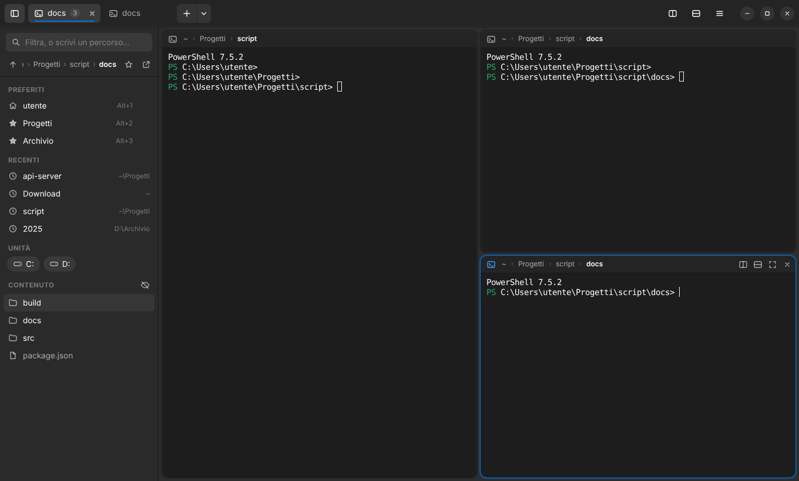
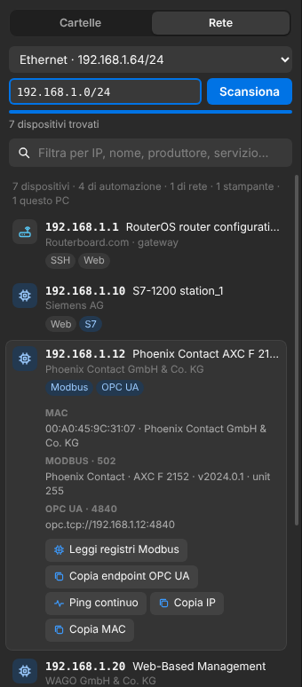
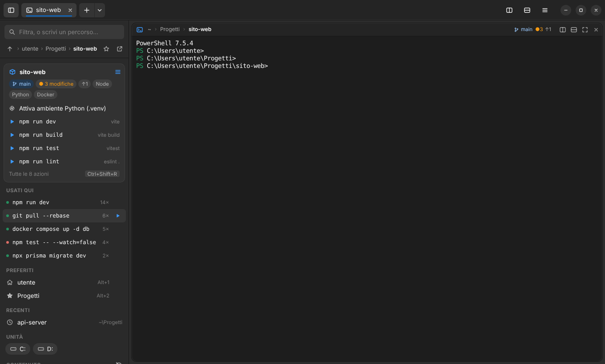
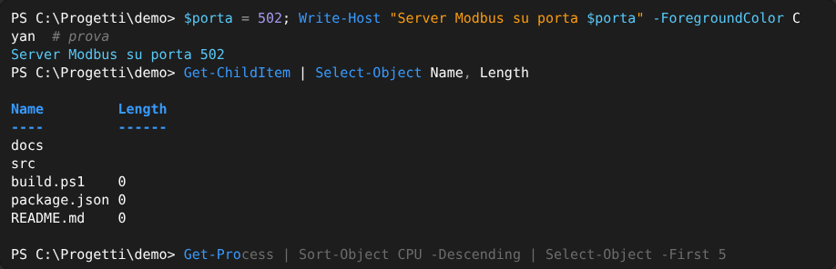

# Trantor

🇬🇧 [English](README.md) · 🇮🇹 Italiano



Terminale moderno per Windows 10/11 in stile **Yaru Dark** (accento blu `#0073E5`).

Il nome viene da **Trantor**, la capitale-pianeta del ciclo della *Fondazione* di Isaac Asimov: una città sconfinata di corridoi e settori, in cui con questo terminale sai sempre dove ti trovi.

Funzioni principali:

- **Schede e pannelli divisi** stile tmux, ma usabili anche col mouse (pulsanti su ogni pannello, divisori trascinabili, doppio clic sul divisore = 50/50)
- **Barra laterale cartelle** che segue il pannello attivo e permette di esplorare liberamente senza spostare il terminale: preferiti, recenti, unità, contenuto della cartella con filtro
- **Salta a cartella** (`Ctrl+G`): ricerca fuzzy su preferiti, cartelle recenti (frecency, come `z`/`zoxide`), sottocartelle e unità
- **Dispositivi in rete**: trova PLC, pannelli, router e server nella rete locale, riconosce Modbus, S7, EtherNet/IP, OPC UA, SSH e interfacce web, e legge i registri Modbus (solo lettura)
- **File e pulsanti di comando**: copia, taglia, incolla, rinomina, zip ed elimina dalla barra laterale (anche con Esplora file), pulsanti per i comandi frequenti, digitazione in tutti i pannelli, terminali da amministratore
- **Trasferire file via SSH**: trascina i file su un pannello remoto per caricarli, trascina fuori il nome di un file per scaricarlo
- **Riorganizzare i pannelli**: trascina i pannelli per spostarli, scambiarli, portarli in un'altra scheda o staccarli in una nuova finestra senza fermare la shell
- **Cartelle intelligenti**: ricorda i comandi che lanci in ogni cartella, riconosce i progetti (git, Node, Python, Docker, .NET…) con azioni a un clic e ripristina le disposizioni dei pannelli salvate per progetto
- **Suggerimenti e colori dei comandi**: suggerimento grigio dalla cronologia, menu di completamento con Tab, colori per comandi, stringhe e numeri (PowerShell), in tonalità Yaru
- **Palette comandi** (`Ctrl+Shift+P`) con tutte le azioni e le scorciatoie
- Sessione (schede, pannelli, cartelle) **ripristinata all'avvio**
- Shell rilevate in automatico: PowerShell 7, Windows PowerShell, Prompt dei comandi, Git Bash, WSL

Basato su Electron + xterm.js + ConPTY (`@lydell/node-pty`, con binari precompilati: **non serve** Visual Studio Build Tools).

## Download

<p>
  <a href="../../releases/latest/download/Trantor-Setup-x64.exe"><b>⬇ Scarica Trantor per Windows</b></a> (installer, x64)
  &nbsp;·&nbsp;
  <a href="../../releases/latest/download/Trantor-Portable-x64.exe">Versione portable</a> (un solo <code>.exe</code>, senza installazione)
</p>

Windows 10 e 11 a 64 bit, non serve installare nient'altro. Versioni precedenti e note di rilascio nella pagina [Releases](../../releases).

- **Installer**: aggiunge Trantor al menu Start e la voce **"Apri in Trantor"** quando fai clic destro su una cartella in Esplora file.
- **Portable**: doppio clic e parte, comoda su chiavetta USB o su PC dove non puoi installare programmi. Si avvia qualche secondo più lentamente.

> **"Windows ha protetto il PC"**: gli eseguibili non hanno ancora una firma digitale, quindi al primo avvio SmartScreen potrebbe avvisarti. Clicca **Ulteriori informazioni → Esegui comunque**.

## Font consigliati

Per l'aspetto Ubuntu completo installa i font ufficiali **Ubuntu** e **Ubuntu Mono** da <https://design.ubuntu.com/font>.
Se mancano, l'app ripiega su Segoe UI e Cascadia Mono / Consolas.

## Scorciatoie

| Tasti | Azione |
|---|---|
| `Ctrl+G` | Salta a cartella (fuzzy) |
| `Ctrl+Shift+L` | Filtra il contenuto della cartella nella barra laterale |
| `Ctrl+H` | Comandi usati in questa cartella |
| `Ctrl+Shift+R` | Azioni del progetto |
| `Ctrl+Shift+O` | Sfoglia cartelle (albero completo) |
| `Ctrl+Shift+N` | Dispositivi in rete |
| `Ctrl+Shift+A` | Digita in tutti i pannelli della scheda |
| `Ctrl+Alt+Shift+frecce` | Scambia il pannello attivo con quello vicino |
| `Alt+Su` | Cartella superiore (con più pannelli: sposta il focus in su) |
| `Alt+1…9` | Vai al preferito n° 1…9 |
| `Ctrl+Shift+S` | Aggiungi/rimuovi la cartella corrente dai preferiti |
| `Ctrl+Shift+D` / `Ctrl+Shift+E` | Dividi a destra / in basso |
| `Alt+Frecce` | Sposta il focus tra i pannelli |
| `Ctrl+Alt+Frecce` | Ridimensiona il pannello attivo |
| `Ctrl+Shift+Z` | Ingrandisci/ripristina pannello (zoom di tmux) |
| `Ctrl+Shift+W` / `Ctrl+Shift+Q` | Chiudi pannello / scheda |
| `Ctrl+Shift+T` | Nuova scheda |
| `Ctrl+Tab`, `Ctrl+1…9` | Cambia scheda |
| `Ctrl+C` (con selezione), `Ctrl+V` | Copia / incolla |
| `Ctrl+Shift+F` | Cerca nel terminale |
| `Ctrl+B` | Mostra/nascondi barra cartelle |
| `Ctrl+=`, `Ctrl+-`, `Ctrl+0`, `Ctrl+rotella` | Dimensione carattere |
| `→` / `Ctrl+→` | Accetta il suggerimento / una parola |
| `Tab` / `↑` `↓` | Menu di completamento / cronologia filtrata |
| `Ctrl+Shift+P` | Palette comandi |
| `F1` | Elenco scorciatoie |

**Barra laterale**: nella lista **Contenuto** un clic **seleziona** un file o una cartella e il doppio clic lo apre (una cartella si apre nella barra laterale, il terminale resta dov'è). Il pulsante **▶** accanto a "Contenuto" apre nel terminale la cartella selezionata, o quella mostrata. Preferiti, recenti e percorso in alto si aprono con un clic; lì il doppio clic apre la cartella anche nel terminale. Mentre esplori, una barra mostra dove si trova il terminale, con **Apri qui** e **Torna**. Clic centrale = nuova scheda. Vuoi che aprire una cartella sposti anche il terminale? Attiva *Aprire una cartella sposta anche il terminale* nel menu ☰.

**Salta a cartella** sposta direttamente il terminale: Invio = pannello corrente · `Ctrl`+Invio = nuova scheda · `Shift`+Invio = pannello a destra · `Alt`+Invio = pannello sotto.
Puoi anche **trascinare una cartella da Esplora file** dentro un pannello per entrarci (un file trascinato inserisce il suo percorso).

Nel campo filtro della barra laterale puoi scrivere un percorso (`D:\Progetti`, `..`, `~\Documents`) e premere Invio; `Backspace` a campo vuoto sale di una cartella.

## Dispositivi in rete



Apri la scheda **Rete** della barra laterale (`Ctrl+Shift+N`), controlla l'intervallo di indirizzi e premi **Scansiona**. Trantor:

- prova le porte più comuni su ogni indirizzo e poi legge la tabella ARP di Windows, così trova anche i dispositivi che non rispondono su nessuna porta;
- mostra il produttore dall'indirizzo MAC (database IEEE);
- riconosce i servizi con richieste di sola lettura: versione SSH, titolo della pagina web, identificazione **Modbus TCP** (produttore, prodotto, versione), nome del prodotto **EtherNet/IP**, risposta **OPC UA** e **Siemens S7**, MQTT, IEC 104, DNP3, Beckhoff ADS, RDP, VNC, stampanti e telecamere;
- raggruppa i dispositivi in automazione, rete, computer, stampanti, telecamere.

Clic su un dispositivo per dettagli e azioni: SSH (scegliendo l'utente), interfaccia web, ping continuo in un nuovo pannello, desktop remoto, copia IP / MAC / endpoint OPC UA, e **Leggi registri Modbus**: holding e input register, coil, ingressi discreti, visualizzati senza segno, con segno, esadecimali, binari o float32, con aggiornamento ogni secondo e i valori cambiati evidenziati. Trantor non scrive mai sui dispositivi.

Usa la scansione solo su reti che gestisci o per cui hai l'autorizzazione.

<br clear="right">

## File

La lista **Contenuto** della barra laterale funziona come un piccolo gestore di file:

- pulsanti: **▶ apri nel terminale**, **Sfoglia cartelle** (albero completo di tutte le unità, `Ctrl+Shift+O`: doppio clic per espandere, poi *Apri nel terminale*), **copia**, **nuova cartella**, **nuovo file**, **incolla**, aggiorna, mostra file nascosti;
- selezione con clic, **Ctrl+clic** e **Shift+clic**: sotto il titolo compare una barra con **copia, taglia, rinomina, duplica, zip, elimina**; le stesse azioni, più incolla ed estrai, sono nel menu del tasto destro;
- da tastiera sulla lista: `Ctrl+C` / `Ctrl+X` / `Ctrl+V`, `F2` rinomina, `Canc` elimina, `Ctrl+A` seleziona tutto;
- trascina gli elementi su una cartella per spostarli (`Ctrl` per copiarli); i file trascinati da Esplora file vengono copiati;
- copia e incolla funzionano anche con Esplora file: i file copiati lì si incollano in Trantor e viceversa.

Gli elementi eliminati finiscono nel **Cestino**, dopo una conferma.

## Pulsanti di comando

Crea pulsanti per i comandi che usi spesso (`npm run build`, uno script di pubblicazione, `docker compose restart`…). Compaiono in una barra sopra i pannelli, ovunque o solo dentro un progetto, ed eseguono nel pannello attivo, in un nuovo pannello o in tutti i pannelli. Si creano dal menu ☰, dalla palette comandi, oppure con tasto destro → *Crea un pulsante* su un comando di "Usati qui" o su un'azione del progetto. Shift+clic esegue un pulsante in un nuovo pannello, Alt+clic in tutti i pannelli, tasto destro per modificarlo.

`Ctrl+Shift+A` manda quello che scrivi a **tutti i pannelli della scheda** (come `synchronize-panes` di tmux); finché è attivo i pannelli hanno il bordo ambra.

## Amministratore

- Tasto destro su un `.exe`, `.bat`, `.cmd`, `.ps1` o `.msi` → **Esegui come amministratore**.
- Tasto destro su una cartella → **Apri terminale come amministratore qui**. Windows non permette a un programma normale di ospitare una shell elevata, quindi Trantor usa [gsudo](https://github.com/gerardog/gsudo) se installato (`winget install gerardog.gsudo`, funziona anche su Windows 10) oppure il **sudo** di Windows 11 impostato su *In linea* (Impostazioni → Per sviluppatori); altrimenti apre una finestra PowerShell da amministratore separata, già in quella cartella. I pannelli elevati hanno il bordo rosso.
- **Riavvia Trantor come amministratore** (palette comandi) riapre tutta l'app con privilegi elevati, mantenendo la sessione.

## Trasferire file (SSH)

Quando lanci `ssh` in un pannello (a mano o con l'azione SSH della vista Rete) il pannello diventa **remoto** e mostra `utente@host` nell'intestazione.

- **Caricare**: trascina file o cartelle da Esplora file o dalla barra laterale sul pannello remoto, conferma la cartella di destinazione e vengono copiati con `scp`.
- **Scaricare**: seleziona il nome di un file nel pannello remoto (per esempio nell'output di `ls`). Compare l'etichetta **Scarica**: cliccala per scaricare nella cartella mostrata nella barra laterale, oppure trascinala su un pannello locale o su una cartella della barra laterale per scegliere dove.
- Nel menu del tasto destro di un pannello remoto ci sono anche *Carica file qui…* e *Scarica un file o una cartella…*.

I trasferimenti eseguono `scp` (incluso in Windows 10 e 11) in un pannello sotto quello remoto: se il server chiede la password la scrivi lì, e il pannello si chiude da solo quando il trasferimento riesce. Porta, chiave (`-i`), host di salto (`-J`) e opzioni `-o` del tuo comando `ssh` vengono riutilizzati.

Trantor conosce la cartella remota solo se il server la comunica. Per bash e zsh scegli **Rileva la cartella remota** dal menu del pannello: la attiva per la sessione corrente. Altrimenti i caricamenti vanno nella cartella home remota, che puoi cambiare prima di confermare.

## Riorganizzare i pannelli

Trascina un pannello dalla sua intestazione:

- sul **bordo** di un altro pannello → si sposta accanto a quello, da quel lato;
- al **centro** di un altro pannello → i due si scambiano;
- su una **scheda** → passa in quella scheda; sul **+** → diventa una scheda a sé;
- **fuori dalla finestra** → si stacca in una nuova finestra. La shell continua a funzionare e il contenuto resta.

Le stesse azioni sono nel menu del tasto destro del pannello. `Ctrl+Alt+Shift+frecce` scambia il pannello attivo con quello vicino.

## Aggiornamenti

La versione installata controlla le nuove release all'avvio e ogni 6 ore. Quando ce n'è una compare il pulsante **Aggiorna** nella barra in alto: scarica l'aggiornamento, poi **Riavvia per aggiornare** lo installa e riapre la sessione. La versione portable mostra il link al nuovo download. Il controllo automatico si può disattivare dalla palette comandi.

## Cartelle intelligenti



Trantor ricorda cosa fai in ogni cartella e riconosce in che tipo di progetto ti trovi.

**Comandi usati qui.** Ogni comando viene salvato con la cartella in cui l'hai lanciato, quante volte, quando e con che esito. La barra laterale mostra i più usati nella cartella corrente; `Ctrl+H` li cerca tutti, anche nelle cartelle superiori del progetto. Clic per inserire un comando, ▶ o doppio clic per eseguirlo, Shift+clic per eseguirlo in un nuovo pannello. Riapri un progetto dopo mesi e vedi subito come si compilava, si avviava o si pubblicava.

**Scheda del progetto.** Se la cartella fa parte di un progetto, la barra laterale ne mostra nome, ramo git, modifiche e le azioni già pronte:

| Riconosciuto da | Azioni |
|---|---|
| `.git` | ramo, modifiche, commit da inviare/ricevere; file modificati segnati nella lista |
| `package.json` | script npm / pnpm / yarn / bun, install se manca `node_modules` |
| `pyproject.toml`, `requirements.txt` | attiva l'ambiente virtuale, installa i requisiti, avvia `main.py`/`app.py`/`manage.py`, pytest |
| `compose.yaml` | `docker compose up -d`, `ps`, `logs -f`, `down` |
| `*.sln`, `*.csproj` | `dotnet build`, `run`, `test` |
| `Makefile`, `Cargo.toml`, `go.mod` | target di make, cargo, go |

`Ctrl+Shift+R` elenca tutte le azioni. Shift+clic esegue un'azione in un nuovo pannello, comodo per i server di sviluppo.

**Disposizioni salvate.** Dal pulsante ☰ della scheda del progetto salvi la disposizione della scheda corrente: pannelli, cartelle e comandi in esecuzione (per esempio `npm run dev` in un pannello e `docker compose logs -f` in un altro). Aprendo il progetto in una nuova scheda (Ctrl+clic, oppure Ctrl+Invio in "Salta a cartella") ritrovi tutta la disposizione.

La cronologia dei comandi funziona con PowerShell, Git Bash e WSL; il Prompt dei comandi (cmd) non comunica i comandi che esegue. Per attivare gli ambienti Python in Windows PowerShell 5.1 i criteri di esecuzione degli script devono permetterlo (`Set-ExecutionPolicy -Scope CurrentUser RemoteSigned`).

## Suggerimenti e colori dei comandi



Trantor attiva le funzioni di modifica della riga che la shell ha già e le colora in stile Yaru:

| | PowerShell 7 | Windows PowerShell 5.1 | Git Bash / WSL |
|---|---|---|---|
| Suggerimento grigio dalla cronologia | ✓ | con PSReadLine 2.1+ ¹ | — ² |
| Menu di completamento con Tab | ✓ | ✓ | ✓ |
| Cronologia filtrata da ciò che hai scritto (↑/↓) | ✓ | ✓ | ✓ |
| Colori della sintassi mentre scrivi | ✓ | ✓ | — ² |

Tasti: **→** o **Fine** accetta il suggerimento, **Ctrl+→** ne accetta una parola, **Tab / Shift+Tab** scorre il menu di completamento, **F2** passa da suggerimento in linea a elenco (PowerShell 7).

Colori: comandi `#389AFE` · parametri, variabili e tipi `#58C7F5` · stringhe `#F99B11` · numeri `#A597EC` · commenti e operatori in grigio · errori `#FF7A71`. Derivano dalla palette ufficiale degli accenti di [Yaru](https://github.com/ubuntu/yaru) e sono volutamente pochi.

¹ Per aggiornarlo: `Install-Module PSReadLine -Scope CurrentUser -Force`.
² Bash non ha suggerimenti in linea né colori della sintassi: si ottengono installando [ble.sh](https://github.com/akinomyoga/ble.sh). Per cmd c'è [Clink](https://github.com/chrisant996/clink).

Queste impostazioni vengono applicate dopo il tuo profilo PowerShell, quindi sostituiscono i tuoi colori e tasti di PSReadLine. Se preferisci i tuoi, disattiva **Suggerimenti e colori nella shell** dal menu ☰ o dalla palette comandi (vale per i nuovi pannelli).

## Come fa a sapere in che cartella sei

All'avvio di ogni shell viene aggiunta una piccola integrazione che, a ogni prompt, invia la sequenza `OSC 9;9` (la stessa usata da Windows Terminal):

- **PowerShell**: avvolge la funzione `prompt` esistente, quindi funziona anche con oh-my-posh/Starship
- **cmd**: imposta la variabile `PROMPT`
- **Git Bash / WSL**: aggiunge un comando a `PROMPT_COMMAND`

Se nel tuo `.bashrc` di WSL sovrascrivi `PROMPT_COMMAND` (invece di aggiungerci), la barra laterale non seguirà i `cd` fatti a mano: in quel caso usa `PROMPT_COMMAND="$PROMPT_COMMAND;..."`.

## Sviluppo

Serve solo se vuoi modificare il codice. Per usare Trantor basta [scaricarlo](#download).

### Avvio dai sorgenti

Serve [Node.js](https://nodejs.org) 20 o superiore. Clona la repository (pulsante verde **Code** su GitHub, oppure scaricala come ZIP), poi dalla sua cartella:

```powershell
npm install
npm start
```

### Creare l'installer e la versione portable

```powershell
npm run dist
```

Trovi in `dist\` sia l'installer sia la versione portable. L'installer aggiunge anche la voce **"Apri in Trantor"** al menu contestuale delle cartelle in Esplora file.

Per pubblicare una release: su GitHub vai in **Releases → Draft a new release**, crea un tag (es. `v1.0.1`) e pubblica. La GitHub Action compila installer e portable e li allega alla release. Prima aggiorna `version` in `package.json`.

### Problemi di installazione

**"Electron failed to install correctly"**: lo script `postinstall` del progetto riscarica Electron in automatico e ne verifica il checksum. Se anche questo fallisce (proxy aziendale), imposta `HTTPS_PROXY` oppure `ELECTRON_MIRROR=https://npmmirror.com/mirrors/electron/` e rilancia `npm install`.

### Struttura

```
scripts/
  ensure-electron.js scarica Electron se lo script ufficiale non l'ha fatto
  check.js           controllo sintassi (npm run lint)
  test.js            test automatici (npm test)
build/               icona e script dell'installer
src/
  main.js            processo principale: finestra, ConPTY, filesystem, configurazione
  preload.js         API esposte all'interfaccia (contextIsolation attivo)
  renderer/
    index.html
    styles.css       tema Yaru Dark (colori derivati da github.com/ubuntu/yaru)
    icons.js         icone simboliche
    app.js           schede, pannelli, barra laterale, picker, scorciatoie
    smart.js         cronologia per cartella, progetti, git, disposizioni
    panes.js         trascinare, scambiare, spostare e staccare i pannelli
    network.js       vista dispositivi in rete e lettura Modbus
    transfer.js      pannelli SSH e trasferimento file (scp)
    files.js         operazioni sui file nella barra laterale, azioni da amministratore
    quickbar.js      pulsanti di comando, digitazione in tutti i pannelli
    updates.js       pulsante di aggiornamento
  netscan.js         scansione di rete, riconoscimento servizi, Modbus TCP
  fileops.js         copia, sposta, rinomina, zip, appunti dei file di Windows
```

Configurazione, preferiti, cronologia e sessione sono salvati in `%APPDATA%\Trantor\config.json`.

## Note sul tema

I colori vengono dai sorgenti ufficiali di Yaru (`gtk/src/default/gtk-3.0/_palette.scss`, `_colors.scss`, `common/accent-colors.scss.in`):
`$jet #181818` → sfondo finestra `#2C2C2C`, viste `#272727`, headerbar `#242424`, bordi `#181818`, testo `$porcelain #F7F7F7`, accento blu `#0073E5`.
La palette ANSI del terminale è quella del profilo Ubuntu di GNOME Terminal.

## Licenza

MIT — vedi [LICENSE](LICENSE).

Progetto indipendente, non affiliato né approvato da Canonical, dal progetto Yaru o dagli eredi di Isaac Asimov. "Ubuntu" è un marchio registrato di Canonical Ltd.
