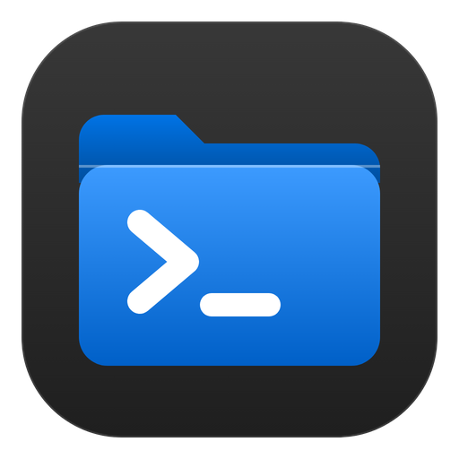
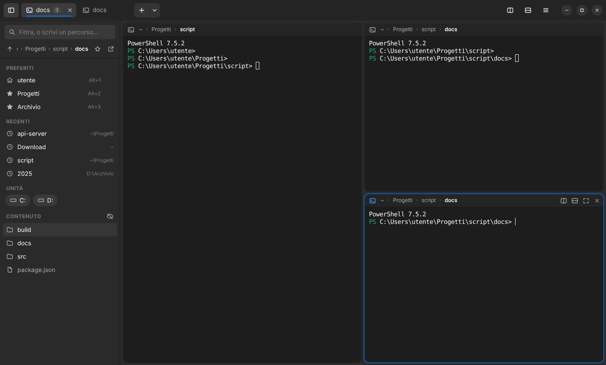
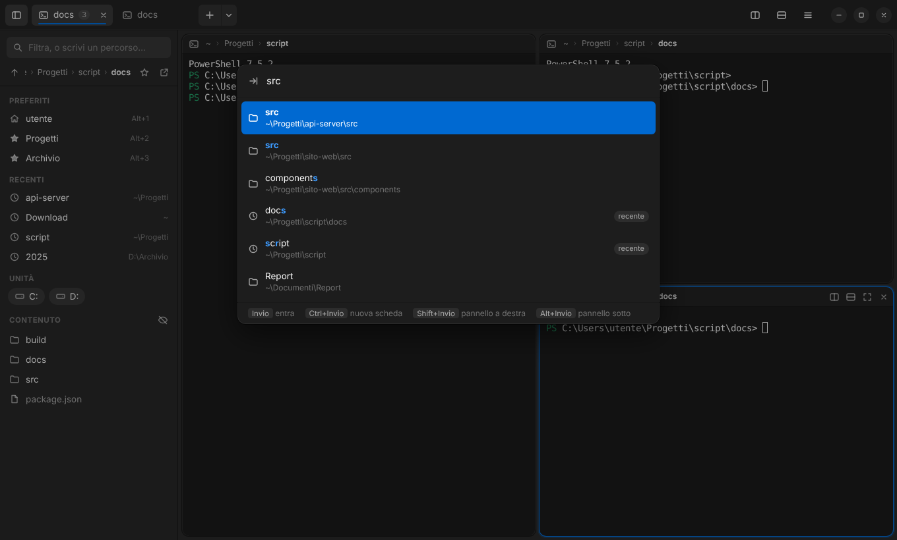
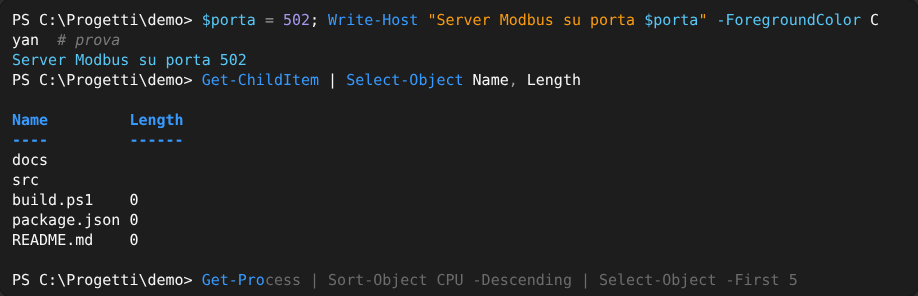

<p align="center">
  
</p>

<h1 align="center">Trantor</h1>

<p align="center">
  A modern terminal for Windows with tmux-style split panes, fast folder navigation and a <b>Yaru Dark</b> look.<br>
  <i>Named after the city-planet of Isaac Asimov's Foundation: endless corridors, and you always know where you are.</i><br>
  🇬🇧 English · 🇮🇹 <a href="README.it.md">Italiano</a>
</p>



## Features

- **Tabs and split panes** like tmux, but mouse-friendly: every pane has split / zoom / close buttons, dividers can be dragged (double-click resets to 50/50).
- **Folder sidebar that follows the active pane**: clickable breadcrumb, bookmarks, frecency-ranked recent folders, drives and the current folder's content with an instant filter.
- **Jump to folder** (`Ctrl+G`): fuzzy search over bookmarks, recent folders (like `z`/`zoxide`), subfolders and drives. Open in the current pane, a new tab or a new split.
- **Command palette** (`Ctrl+Shift+P`) with every action and its shortcut.
- **Session restore**: tabs, splits and folders come back when you reopen the app.
- **Shells detected automatically**: PowerShell 7, Windows PowerShell, Command Prompt, Git Bash, WSL.
- **Explorer integration**: "Open in Trantor" context-menu entry, drag a folder onto a pane to `cd` into it.
- **Command suggestions and syntax colors**: grey inline suggestions from history, Tab completion menu, colors for commands, strings and numbers (PowerShell), all in Yaru tones.
- **Yaru Dark theme** with the official Yaru blue accent (`#0073E5`), Ubuntu terminal palette, WebGL rendering.



> The interface is currently in Italian. Translations are welcome, see [CONTRIBUTING](CONTRIBUTING.md).

## Install

Download the installer or the portable `.exe` from [Releases](../../releases).

## Run from source

Requires [Node.js](https://nodejs.org) 20+. Clone the repository (green **Code** button on GitHub, or download it as ZIP), then from its folder:

```powershell
npm install
npm start
```

Build the installer and the portable version into `dist\`:

```powershell
npm run dist
```

## Keyboard shortcuts

| Keys | Action |
|---|---|
| `Ctrl+G` | Jump to folder |
| `Ctrl+Shift+L` | Filter the current folder in the sidebar |
| `Alt+Up` | Parent folder (moves focus up when there are several panes) |
| `Alt+1…9` | Go to bookmark 1…9 |
| `Ctrl+Shift+S` | Bookmark / unbookmark the current folder |
| `Ctrl+Shift+D` / `Ctrl+Shift+E` | Split right / down |
| `Alt+Arrows` | Move focus between panes |
| `Ctrl+Alt+Arrows` | Resize the active pane |
| `Ctrl+Shift+Z` | Zoom / unzoom pane |
| `Ctrl+Shift+W` / `Ctrl+Shift+Q` | Close pane / tab |
| `Ctrl+Shift+T` | New tab |
| `Ctrl+Tab`, `Ctrl+1…9` | Switch tab |
| `Ctrl+C` (with selection), `Ctrl+V` | Copy / paste |
| `Ctrl+Shift+F` | Find in terminal |
| `Ctrl+B` | Toggle sidebar |
| `Ctrl+=`, `Ctrl+-`, `Ctrl+0`, `Ctrl+wheel` | Font size |
| `→` / `Ctrl+→` | Accept the suggestion / one word of it |
| `Tab` / `↑` `↓` | Completion menu / history filtered by what you typed |
| `Ctrl+Shift+P` | Command palette |
| `F1` | Shortcut list |

Mouse, in the sidebar and in Jump to folder: click = enter · `Ctrl`+click or middle-click = new tab · `Shift`+click = split right · `Alt`+click = split down · right-click = menu.

## Suggestions and syntax colors



Trantor turns on the line-editing features that your shell already has and styles them in Yaru colors:

| | PowerShell 7 | Windows PowerShell 5.1 | Git Bash / WSL |
|---|---|---|---|
| Grey inline suggestion from history | ✓ | with PSReadLine 2.1+ ¹ | — ² |
| Tab completion menu | ✓ | ✓ | ✓ |
| History search filtered by what you typed (↑/↓) | ✓ | ✓ | ✓ |
| Syntax colors while typing | ✓ | ✓ | — ² |

Keys: **→** or **End** accepts the suggestion, **Ctrl+→** accepts one word, **Tab / Shift+Tab** moves through the completion menu, **F2** switches between inline and list suggestions (PowerShell 7).

Colors: commands `#389AFE` · parameters, variables and types `#58C7F5` · strings `#F99B11` · numbers `#A597EC` · comments and operators in grey · errors `#FF7A71`. They are derived from the official [Yaru](https://github.com/ubuntu/yaru) accent palette and kept to a few tones on purpose.

¹ Update it with `Install-Module PSReadLine -Scope CurrentUser -Force`.
² Bash has no built-in inline suggestions or highlighting: install [ble.sh](https://github.com/akinomyoga/ble.sh) to get them. For cmd, [Clink](https://github.com/chrisant996/clink) adds both.

These settings are applied after your PowerShell profile, so they override your own PSReadLine colors and key bindings. If you prefer your setup, turn off **Suggerimenti e colori nella shell** in the ☰ menu or the command palette (applies to new panes).

## How the sidebar knows your folder

Each shell gets a tiny integration that emits `OSC 9;9` (the same sequence Windows Terminal uses) at every prompt:

- **PowerShell** wraps your existing `prompt` function, so oh-my-posh and Starship keep working.
- **cmd** sets the `PROMPT` variable.
- **Git Bash / WSL** append to `PROMPT_COMMAND`.

If your WSL `.bashrc` *overwrites* `PROMPT_COMMAND`, append to it instead (`PROMPT_COMMAND="$PROMPT_COMMAND;..."`).

## Fonts

For the full Ubuntu look install **Ubuntu** and **Ubuntu Mono** from <https://design.ubuntu.com/font>. Otherwise the app falls back to Segoe UI and Cascadia Mono / Consolas.

## Troubleshooting

**`Electron failed to install correctly`**: the project's `postinstall` script re-downloads Electron and verifies its SHA-256 checksum. If that also fails behind a corporate proxy, set `HTTPS_PROXY`, or `ELECTRON_MIRROR=https://npmmirror.com/mirrors/electron/`, and run `npm install` again.

## Releasing

On GitHub go to **Releases → Draft a new release**, create a tag such as `v1.0.1` and publish it. GitHub Actions builds the installer and the portable executable and attaches them to that release. Remember to bump `version` in `package.json` first.

## Project structure

```
src/
  main.js              main process: window, ConPTY, filesystem, settings
  preload.js           API exposed to the UI (context isolation on)
  renderer/
    index.html
    styles.css         Yaru Dark theme
    icons.js           symbolic icons
    app.js             tabs, panes, sidebar, pickers, shortcuts
scripts/
  ensure-electron.js   fallback Electron download
  check.js             syntax check (npm run lint)
build/                 icons and installer script
```

Settings, bookmarks, history and session are stored in `%APPDATA%\Trantor\config.json`.

## Credits

- Colors derived from the official [Yaru](https://github.com/ubuntu/yaru) sources (`$jet #181818`, `$porcelain #F7F7F7`, blue accent `#0073E5`).
- Built with [Electron](https://www.electronjs.org), [xterm.js](https://xtermjs.org) and [node-pty](https://github.com/microsoft/node-pty) (prebuilt binaries by [@lydell/node-pty](https://www.npmjs.com/package/@lydell/node-pty)).

## License

MIT, see [LICENSE](LICENSE).

This is an independent project and is not affiliated with or endorsed by Canonical, the Yaru project or the Asimov estate. "Ubuntu" is a registered trademark of Canonical Ltd.
